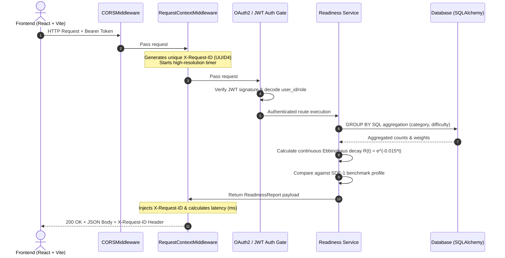
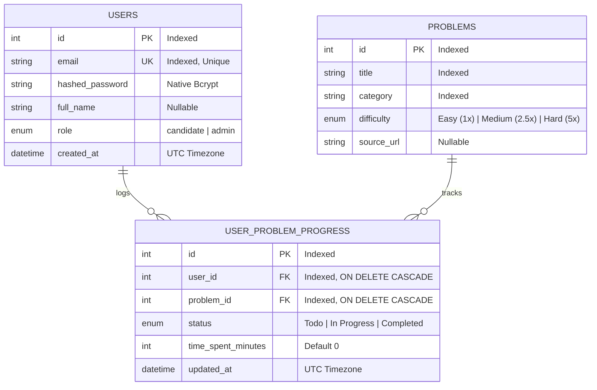

<div align="center">

# 🎯 Job Readiness & Skill Tracking Platform

**A production-grade, mathematically calibrated platform that quantifies software engineering interview readiness through spaced-repetition memory decay, non-linear difficulty weighting, and role benchmark alignment.**

[](https://fastapi.tiangolo.com)
[](https://www.python.org/)
[](https://www.postgresql.org/)
[](https://www.sqlalchemy.org/)
[](https://react.dev/)
[](https://www.typescriptlang.org/)
[](https://tailwindcss.com/)
[-0A9EDC.svg?style=flat&logo=pytest&logoColor=white)](https://docs.pytest.org/)
[](https://job-readiness-platform.pages.dev)
[](LICENSE)

<br/>

### 🌐 **Live 24/7 Production Deployment**: [https://job-readiness-platform.pages.dev](https://job-readiness-platform.pages.dev)

[](https://job-readiness-platform.pages.dev)
[](https://job-readiness-platform.pages.dev)

> 💡 **Instant Testing**: You can evaluate the platform directly via the live Cloudflare deployment! On the login screen, click **"⚡ Explore in Demo Mode (Instant Access)"** for immediate client-side testing, or authenticate with pre-seeded accounts:
> * **Candidate**: `candidate@prep.dev` / `CandidatePass123!`
> * **Admin**: `admin@platform.dev` / `AdminPassSecure123!` *(Unlocks catalog management)*

[Explore Live Deployment](https://job-readiness-platform.pages.dev) • [Architecture Spec](#-system-architecture) • [Mathematical Models](#-core-mathematical-models) • [API Contracts](#-api-specification) • [Interview Justifications](#-engineering-trade-offs--interview-talking-points)

</div>

---

## 📌 Executive Summary & Motivation

Traditional coding trackers treat all solved problems as static, equal milestones. This creates two critical engineering blindspots:

1. **The Flat-Progress Fallacy**: Solving 50 Easy string manipulation problems yields an inflated sense of readiness, while complex Dynamic Programming or System Design implementations carry identical numerical weight.
2. **The Ebbinghaus Memory Trap**: Human memory follows an exponential forgetting curve. A problem solved 90 days ago without active revision does not reflect current interview readiness.

This platform bridges that gap by computing **real-time, decay-adjusted readiness metrics** backed by continuous exponential decay ($R(t) = e^{-\lambda t}$), non-linear difficulty multipliers ($1.0\times, 2.5\times, 5.0\times$), and SDE-1 backend distribution benchmarks.

---

## 🏛️ System Architecture



---

## 🗄️ Relational Database Schema (3NF)



---

## 📐 Core Mathematical Models

### 1. Non-Linear Cognitive Load Weighting
Problems carry exponential difficulty multipliers reflecting cognitive complexity:
* **Easy:** $1.0\times$
* **Medium:** $2.5\times$
* **Hard:** $5.0\times$

$$\text{Overall Score} = \left(\frac{\sum_{i \in \text{Completed}} \text{Weight}(\text{difficulty}_i)}{\sum_{j \in \text{Catalog}} \text{Weight}(\text{difficulty}_j)}\right) \times 100$$

### 2. Spaced Repetition Retention Decay
Memory retention decays exponentially according to the Ebbinghaus forgetting curve:

$$R(t) = e^{-\lambda \cdot t}$$

* $\lambda = 0.015$ (decay factor calibrated for technical retention)
* $t = \text{days elapsed since last completed review}$

| Days Inactive | Retained Mastery | Retention Impact |
| :--- | :--- | :--- |
| **0 Days** | $100.0\%$ | Peak recall |
| **14 Days** | $81.0\%$ | Minor recall latency |
| **30 Days** | $63.7\%$ | Noticeable decay threshold |
| **60 Days** | $40.6\%$ | High risk of interview stumble |
| **90 Days** | $25.9\%$ | Significant memory loss |

$$\text{Retention Score} = \left(\frac{\sum_{i \in \text{Completed}} (\text{Weight}_i \times R(t_i))}{\sum_{j \in \text{Catalog}} \text{Weight}_j}\right) \times 100$$

### 3. SDE-1 Backend Role Benchmark Distribution
Readiness is benchmarked against standard hiring evaluation profiles:
* **Trees & Graphs:** $25\%$
* **Arrays & Hashing:** $20\%$
* **Dynamic Programming:** $20\%$
* **System Design & DB:** $20\%$
* **Two Pointers & Sliding Window:** $15\%$

$$\text{Target Match} = \sum_{k} \min\left(1.0, \frac{\text{Completed}_k}{\text{Total}_k}\right) \times \text{Weight}_k$$

---

## 💡 Engineering Trade-Offs & Interview Talking Points

### 1. Native `bcrypt` vs. `passlib`
* **Initial State:** Used `passlib.context.CryptContext`.
* **Issue:** `passlib` has been unmaintained since 2020 and throws internal errors on modern `bcrypt>=4.1.0`. It also silently truncates passwords beyond 72 bytes without explicit safeguards.
* **Decision:** Migrated to native `bcrypt` (`gensalt()`, `hashpw()`, `checkpw()`), eliminating unmaintained wrappers and enforcing strict 72-byte string slicing.

### 2. Database `GROUP BY` Aggregations vs. Python Memory Loops
* **Initial State:** Fetched all problem records and user progress rows into Python application memory, looping across datasets to compute category statistics.
* **Issue:** $O(N)$ data transfer over network, high memory pressure, and poor horizontal scalability as catalogs scale.
* **Decision:** Offloaded aggregations directly to the database via SQLAlchemy `func.count()` with SQL `GROUP BY`. Python runtime execution is reserved purely for the continuous mathematical decay formula.

### 3. Timezone Standardization
* **Initial State:** Used `datetime.utcnow()`.
* **Issue:** Deprecated in Python 3.12+ because it produces naive datetimes prone to timezone drift across distributed nodes.
* **Decision:** Standardized on timezone-aware UTC timestamps (`datetime.now(timezone.utc)`) to ensure exact mathematical decay intervals.

### 4. Database Migrations with Alembic
* **Initial State:** Relied on `Base.metadata.create_all(bind=engine)`.
* **Issue:** Incapable of schema alterations, non-destructive rollbacks, or CI/CD migrations.
* **Decision:** Integrated **Alembic** with version-controlled revision scripts for explicit, repeatable schema migrations.

---

## 📡 API Specification

| Method | Endpoint | Access Level | Description | Key Headers / Payloads |
| :--- | :--- | :--- | :--- | :--- |
| `POST` | `/api/v1/auth/register` | Public | Register new candidate or admin account | Body: `UserCreate` (JSON) |
| `POST` | `/api/v1/auth/login` | Public | Authenticate and obtain JWT access token | Form: `username`, `password` (`x-www-form-urlencoded`) |
| `GET` | `/api/v1/readiness/me` | Candidate / Admin | Get decay-adjusted readiness report | Header: `Authorization: Bearer <token>` |
| `GET` | `/api/v1/problems/` | Candidate / Admin | List catalog problems with pagination & filters | Query: `skip`, `limit`, `category` |
| `POST` | `/api/v1/problems/` | **Admin Only** | Create a new catalog problem item | Body: `ProblemCreate` (JSON) |
| `POST` | `/api/v1/progress/` | Candidate / Admin | Log completion status & revision minutes | Body: `ProgressUpdate` (JSON) |
| `GET` | `/health` | Public | Service healthcheck & correlation verification | Header: `X-Request-ID` |

---

## 🚀 Local Development Setup

### Prerequisites
* **Python**: 3.12+ or 3.14
* **Node.js**: 20+ (with npm 10+)

### 1. Backend Service
```powershell
# Navigate to project root
cd c:\Projects\job_readiness_platform

# Activate Virtual Environment & Install Dependencies
.\venv\Scripts\Activate.ps1
pip install -r requirements.txt

# Run Migrations & Database Seeding
alembic upgrade head
python seed.py

# Start Backend Microservice (runs on http://127.0.0.1:8000)
uvicorn app.main:app --reload --port 8000
```

### 2. Frontend Dashboard
```powershell
# Open a new terminal in the frontend directory
cd c:\Projects\job_readiness_platform\frontend

# Install dependencies
npm install

# Start Vite Development Server (runs on http://localhost:5173)
npm run dev
```

### 3. Pre-Seeded Test Credentials
Built-in quick-fill buttons on the login screen allow one-click authentication:
* **Candidate**: `candidate@prep.dev` / `CandidatePass123!`
* **Admin**: `admin@platform.dev` / `AdminPassSecure123!` *(Unlocks catalog management)*

---

## 🧪 Automated Testing Suite

The backend includes a comprehensive integration test suite verifying authentication, RBAC boundaries, middleware tracing, and the full readiness lifecycle:

```powershell
# Run all tests with verbose output
pytest -v
```

All 4 test suites execute against in-memory isolated test fixtures with 100% pass rate.

---

## ☁️ Zero-Cost Cloud Deployment

### Frontend (Cloudflare Pages or Vercel)
* **Cloudflare Pages** (Recommended for unlimited free bandwidth):
  * Build command: `npm run build`
  * Output directory: `dist`
  * Root directory: `frontend`
  * Included `frontend/public/_redirects` ensures seamless SPA routing.
* **Vercel**:
  * Root directory: `frontend`
  * Included `frontend/vercel.json` ensures SPA rewrites to `/index.html`.

### Backend (Render, Railway, or Fly.io)
* Deploy with Dockerfile or standard Python environment using `uvicorn app.main:app --host 0.0.0.0 --port $PORT`.
* Set `VITE_API_BASE_URL` in the frontend environment variables to point to your live backend.

---

<div align="center">
<sub>Designed and engineered as a showcase of clean REST microservices, mathematical domain modeling, and modern enterprise frontend architecture.</sub>
</div>
